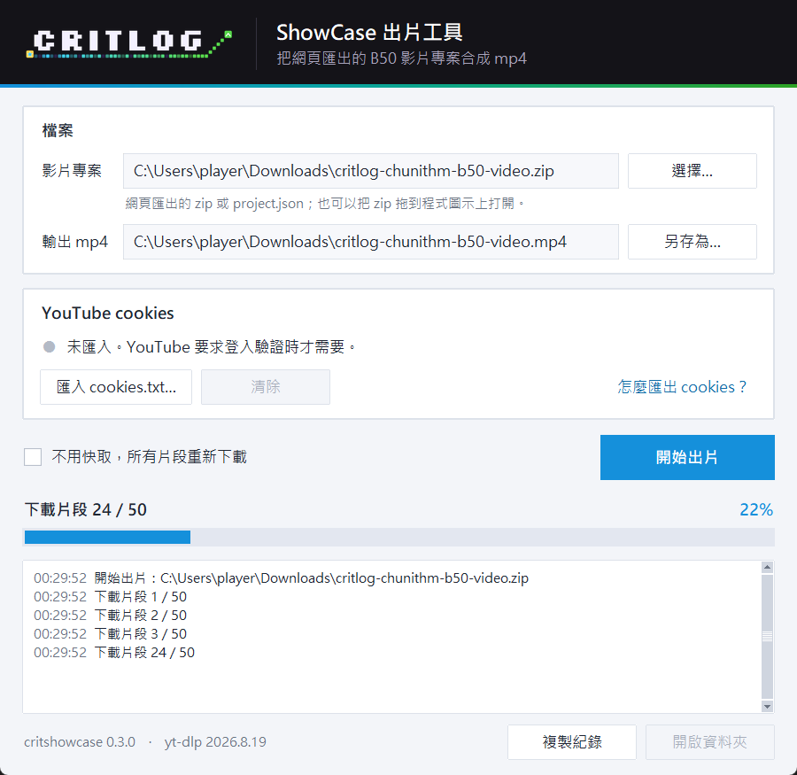

# CRITShowCase

[](https://github.com/ryrr6466/CRITShowCase/releases/latest)
[](https://github.com/ryrr6466/CRITShowCase/actions/workflows/windows-build.yml)
[](LICENSE)

把 [critlog.me](https://critlog.me) 匯出的 CHUNITHM B50 影片專案，在你自己的電腦上合成一支 mp4。



在 critlog.me 的 CRITShowCase 頁面排好 B50、挑好每首歌的 YouTube 片段後，網頁會匯出一個影片專案（zip）。這個工具負責剩下的事：

- 下載每首歌需要的那一小段 YouTube 影片
- 把片段塞進網頁畫好的畫面（曲名、成績、評論、非官方標示都由網頁畫好，工具自己不畫任何文字）
- 接上轉場，輸出 1920×1080、60 fps 的 mp4

這是非官方工具，與 SEGA 無關。

## 下載

| 系統 | 下載 | 說明 |
|---|---|---|
| Windows 10／11（64 位元） | [`critshowcase-<版本>-windows-x64.zip`](https://github.com/ryrr6466/CRITShowCase/releases/latest) | 解壓即用 |
| macOS 12 以上（Apple Silicon） | [`critshowcase-<版本>-macos-arm64.zip`](https://github.com/ryrr6466/CRITShowCase/releases/latest) | 已簽章、經 Apple 公證 |
| Intel Mac、Linux | 用 pip 安裝 | 見[其他安裝方式](#其他安裝方式) |

兩個免安裝版都附好了 Python、ffmpeg 與 Deno，不必另外安裝任何東西。

### Windows

1. 解壓到任何地方。整個 `critshowcase` 資料夾要放在一起，不要只複製裡面的 exe。
2. 雙擊 `critshowcase-gui.exe`。

第一次執行時，Windows 可能跳出「Windows 已保護您的電腦」（SmartScreen），因為這個 exe 沒有程式碼簽章。按「其他資訊」→「仍要執行」即可。

### macOS

1. 雙擊解壓，把 `CRITShowCase.app` 拖到「應用程式」資料夾。
2. 打開 `CRITShowCase.app`。

### 更新

YouTube 常常改版。很多片段突然下載失敗時，先下載最新版：Windows 解壓後取代舊的資料夾，macOS 取代舊的 app。下載過的片段與匯入的 cookies 都會保留。

## 使用方式

1. 按「選擇…」選網頁匯出的影片專案 zip。也可以直接把 zip 拖到程式圖示上（macOS 可以拖到 Dock 上的圖示）。
2. 成品預設放在 zip 旁邊，按「另存為…」可以換位置。
3. 按「開始出片」。進度條會走過下載片段、合成段落、輸出 mp4 三個階段；最後輸出 mp4 只有一步，沒有百分比，狀態文字會一直動。
4. 完成後按「開啟資料夾」找到成品。

出片中關閉視窗會先確認。已經下載好的片段會留在快取，下次不必重新下載。

## 遇到問題

### 出現「YouTube 要求登入驗證」

YouTube 有時會要求證明你不是機器人，這時需要匯入你的 YouTube cookies：

1. 按「怎麼匯出 cookies？」，照著教學用瀏覽器擴充功能匯出 `cookies.txt`。教學會請你在無痕視窗登入，因為從一般視窗匯出的 cookies 很快就會失效。
2. 按「匯入 cookies.txt…」選匯出的檔案。之後出片都會自動使用。

- cookies 等於你的 YouTube 登入狀態，不要傳給別人。匯入的是一份複本，原本的檔案可以刪掉。
- 建議用分身帳號：YouTube 可能會停用被拿來下載影片的帳號。
- 之後又出現同樣的訊息，代表 cookies 失效了，照同樣步驟重新匯出、匯入即可。

### 有些片段下載失敗

片段下載不到（影片被刪、設成私人、地區限制、網路錯誤）時，那一段會改成靜態畫面加靜音，整支影片照樣輸出，結束時會列出是哪幾段。回 CRITShowCase 頁面換掉這些片段、重新匯出後再出一次即可。

很多片段同時失敗，通常是 YouTube 改版了，請先[更新](#更新)。

### 回報問題

到 [Issues](https://github.com/ryrr6466/CRITShowCase/issues) 開一個新問題，附上：

- 按「複製紀錄」複製的整段紀錄
- 視窗左下角的版本（例如 `critshowcase 0.3.0 · yt-dlp 2026.8.19`）
- 作業系統

請不要附上 cookies.txt 或含有個人資訊的檔案。

## 隱私

- 所有處理都在你的電腦上進行。工具只會連上 YouTube 下載片段，不會回傳任何資料，也不會自動檢查更新。
- 匯入的 cookies 只存在你的電腦，只用來下載 YouTube 片段。按「清除」或直接刪掉檔案就不再使用。

| | Windows | macOS | Linux |
|---|---|---|---|
| 片段快取 | `%LOCALAPPDATA%\critshowcase\clips` | `~/Library/Caches/critshowcase/clips` | `~/.cache/critshowcase/clips` |
| 匯入的 cookies | `%LOCALAPPDATA%\critshowcase\cookies.txt` | `~/Library/Application Support/critshowcase/cookies.txt` | `~/.cache/critshowcase/cookies.txt` |

想清除快取，直接刪掉 `clips` 資料夾即可。

## 使用提醒

把別人的譜面影片剪進自己的影片再上傳，可能會被原作者或權利人申訴。這個工具只是讓下載發生在你自己的電腦上，不代表可以任意轉載。請先確認來源頻道的轉載規定，或改用自己的手元影片（上傳成不公開影片後，在網頁上貼網址）。

畫面上的非官方標示不能拿掉。

## 命令列

免安裝版也附了命令列版：Windows 是資料夾裡的 `critshowcase.exe`（也可以直接把 zip 拖到它上面出片），macOS 是 `CRITShowCase.app/Contents/MacOS/critshowcase`。

```bash
critshowcase critlog-chunithm-b50-video.zip
```

| 選項 | 說明 |
|---|---|
| `-o 檔案.mp4` | 輸出位置（預設放在輸入檔旁邊） |
| `--cookies cookies.txt` | 使用匯出的 cookies 檔 |
| `--cookies-from-browser firefox` | 直接讀瀏覽器的 cookies（瀏覽器要先登入 YouTube） |
| `--refresh` | 不用快取，所有片段重新下載 |
| `--verbose` | 印出 yt-dlp 的詳細訊息（除錯用） |
| `--version` | 印出 critshowcase 與 yt-dlp 的版本 |

- 輸入可以是網頁匯出的 zip，或解開後的 `project.json`。
- Windows 上的 Edge／Chrome 開著時會鎖住 cookie 資料庫，要完全關閉（包含背景程序）才讀得到；Firefox 沒有這個問題。
- 命令列不會使用 GUI 匯入的 cookies，要自己加 `--cookies` 或 `--cookies-from-browser`。

| 結束碼 | 意思 |
|---|---|
| 0 | 完成 |
| 1 | 沒有輸出：影片專案不能用、找不到 ffmpeg／yt-dlp、讀不到 cookies、YouTube 要求登入驗證，或 ffmpeg 失敗 |
| 3 | 有輸出，但有片段下載失敗、改成靜態畫面 |

## 其他安裝方式

Intel Mac、Linux，或想自己管理 Python 環境時，可以用 pip 安裝。需要：

- Python 3.10 以上（GUI 需要 tkinter；Linux 沒有的話安裝 `python3-tk`）
- [ffmpeg](https://ffmpeg.org/download.html)：`ffmpeg` 與 `ffprobe` 要能在命令列執行
- [Deno](https://deno.com/) 或 [Node.js](https://nodejs.org/)：yt-dlp 要用它解 YouTube 的驗證，沒有的話很多片段會下載失敗

```bash
pip install git+https://github.com/ryrr6466/CRITShowCase.git
critshowcase-gui
```

[yt-dlp](https://github.com/yt-dlp/yt-dlp) 會一起裝好。片段下載失敗時，先更新 yt-dlp：

```bash
pip install -U "yt-dlp[default]"
```

## 參與開發

```bash
python -m venv .venv
.venv/Scripts/python -m pip install -e ".[test]"   # macOS／Linux 是 .venv/bin/python
.venv/Scripts/python -m mypy src
.venv/Scripts/python -m pytest
```

測試會實際呼叫 ffmpeg（要先裝好），不會連上 YouTube。

- 各模組的用途寫在 `src/critshowcase` 每個檔案開頭的說明。
- 建置免安裝版、簽章與發布流程見 [docs/building.md](docs/building.md)。
- 歡迎開 Issue 或 Pull Request。修改行為時請一併補上測試。

## 授權

- 程式碼以 [MIT License](LICENSE) 授權。
- **CRITLOG 的名稱、字標與 icon 不在 MIT 授權範圍內**（`src/critshowcase/gui/assets`、`packaging/critshowcase.ico`、`packaging/critshowcase.icns`）。fork 或修改後發布時，請換成你自己的名稱與圖示。
- 免安裝版另外附帶了 ffmpeg（GPLv3）、Deno（MIT）、Python 與 Tcl／Tk 等元件，各自依其授權發布。授權文字與 ffmpeg 原始碼的取得方式，放在下載的 zip 裡的 `licenses` 資料夾。
- CHUNITHM 是 SEGA 的商標。本專案與 SEGA 無關。
